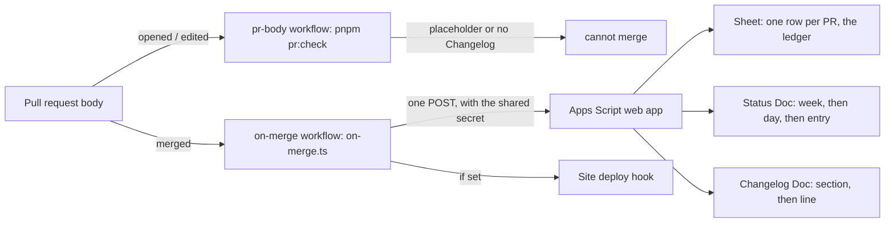

# Reporting

Reports written by hand get skipped. A pull request already says what changed, why and how long it
took, so merging it files everything. Automation commits nothing to `main`: the pull request is the
record.



## What the pull request body carries

```md
## Changelog

(<time>) Checks the 301 map against the plan.

Section: Search & sharing
Time-Spent: 1h30m
```

- **Changelog**: the first line of the section. `(<time>)` at the start is replaced with the time
  spent. "No user-facing change" (or an "(internal)" line) files no changelog line.
- **Section**: one of Search & sharing, Visitors, Sales & prices, Leads, Security & email,
  Launch day, Reliability, Docs, Tooling. Anything else falls back to Reliability.
- **Time-Spent**: trailers in the body (and in commit messages), such as `45m`, `2h`, `1h30m` or
  `1.5h`, added up. Time is never guessed.
- The day and week are the Pacific (America/Los_Angeles) day of the merge, so a merge at 11:30 PM
  Pacific is filed under that evening, not the next UTC day.

Check a body locally before you open the pull request:

```bash
pnpm pr:check -- /path/to/pr-body.md
```

## Secrets (by name only)

| Name                 | Where                       | What                                                             |
| -------------------- | --------------------------- | ---------------------------------------------------------------- |
| `REPORT_POST_URL`    | repository secret           | The Apps Script web app's `/exec` address                        |
| `REPORT_POST_SECRET` | repository secret           | Shared secret, also set as the script's `REPORT_SECRET` property |
| `DEPLOY_HOOK_URL`    | repository secret, optional | The site's deploy hook, called after a successful report         |

The Apps Script (`automation/google-apps-script/Code.gs`) reads four Script Properties:
`REPORT_SECRET`, `SHEET_ID`, `STATUS_DOC_ID`, `CHANGELOG_DOC_ID`. Until the repository secrets are
set, the on-merge workflow does nothing.

## Re-filing a pull request

Re-run the "On merge" workflow for it. The Sheet is the ledger: the script finds the pull
request's id (`pr-<number>`) in column A and changes nothing, so nothing is filed twice.
